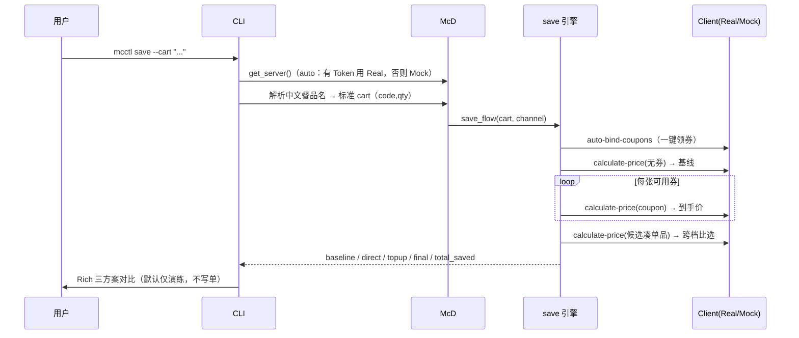

# 架构设计（ARCHITECTURE）

`mcctl` 用一套业务逻辑同时驱动**真实 MCP** 与**离线 Mock**，并暴露 CLI、Python SDK、Agent Skill、网页 Playground 四种形态。

## 1. 分层总览

```mermaid
flowdir TB
    subgraph 入口
      CLI[Typer / Rich 命令行 cli.py]
      SKILL[Agent Skill skill/SKILL.md]
      WEB[静态网页 Playground web/]
      SDK[Python SDK service.McD]
    end
    subgraph 业务编排层 service.py
      McD[McD 业务门面]
      ENG1[engines/persona.py 人格计分]
      ENG2[engines/diet.py 配餐组合搜索]
      ENG3[engines/decide.py 人格化决策]
      ENG4[engines/save.py 省钱/凑单]
    end
    subgraph MCP 接入层
      REAL[mcp_client.py RealMCPClient\n官方 mcp SDK · Streamable HTTP]
      MOCK[mock_client.py MockMCPClient\n33 工具状态机]
    end
    DATA[(data/personas.json\nmock_data.py 演示数据)]
    MCD[(麦当劳官方 MCP\nhttps://mcp.mcd.cn · 33 tools)]

    CLI --> McD
    SKILL -.指导 Agent 调用.-> CLI
    SDK --> McD
    WEB -.内嵌同构计分逻辑.-> ENG1
    McD --> ENG1 & ENG2 & ENG3 & ENG4
    ENG1 --> DATA
    ENG2 --> MOCK
    McD --> REAL
    McD --> MOCK
    REAL -->|Bearer Token| MCD
```

## 2. 模块职责

| 路径 | 职责 |
|---|---|
| `cli.py` | Typer 命令树、全局开关（`--mock/--live/--json/--token`）、中文餐品名解析、交易 `--confirm` 护栏、Rich 渲染调度 |
| `config.py` | `Settings`：读取 `.env` / 环境变量，判定 `auto/live/mock` 模式；无 Token 自动 Mock |
| `mcp_client.py` | `RealMCPClient`：官方 `mcp` SDK 的 `streamablehttp_client + ClientSession`，封装 `initialize / tools/list / tools/call`，解析 `CallToolResult`，健康检查与降级信号 |
| `mock_client.py` | `MockMCPClient`：与官方同名的 33 个工具，内含领券、算价、门槛、配送费、下单、取消、抽奖、积分、派对的状态机 |
| `service.py` | `get_server` 工厂、`McD` 业务门面（把多工具编排成"配餐/省钱/下单/积分/派对"），以及对官方返回的容错解析（`parse_meal/parse_coupon/parse_store`） |
| `models.py` | `Meal / Coupon / Store / PriceBreakdown / Order / Campaign / PointsAccount / MallProduct` 等 dataclass |
| `mock_data.py` | 贴近真实的非官方演示数据：餐品+营养+价格、券、门店、地址、当月活动、积分、商城、抽奖概率 |
| `engines/persona.py` | 加载 `personas.json`，10 题计分、8 型结果、麦籍卡文案 |
| `engines/diet.py` | 槽位枚举组合搜索；控卡 / 非控卡两套打分；热量、蛋白、预算、忌口、时段、人数、本命餐、标签约束 |
| `engines/decide.py` | 人格权重 → 营养约束 → 配餐搜索 → 人格化理由 |
| `engines/save.py` | 一键领券 → 基线价 → 逐券试算 → 凑单 / 免配送费比选 |
| `ui.py` | Rich 横幅、表格、面板、订单 / 价格 / 账户渲染，麦当劳金 `#FFC72C` / 红 `#DA291C` / 绿 `#2E9E5B` |
| `data/personas.json` | 8 型人格权重、本命餐、标签、配色、文案与 10 道测试题（网页与 CLI 共用同一套数据语义） |

## 3. 一次命令的数据流（以 `mcctl save` 为例）



## 4. 真实 / Mock 双客户端如何共存

- 两者**方法签名一致**（都实现 `tools() / health_check() / call_tool(name, args)`），`McD` 面向同一接口编程。
- `get_server(settings)`：`mode=live` 强制真实；`mock` 强制离线；`auto` 时先做健康检查（401 / 网络失败 / 未配置 Token 即降级 Mock）。
- 业务引擎只依赖 `McD` 返回的结构化模型，因此**同一份省钱 / 配餐逻辑在两种数据源下行为一致**。
- 所有输出都会标注当前模式，避免把演示数据误当官方实时数据。

## 5. 安全设计

- 写操作（下单、取消、领券、兑换、抽奖、派对预约）在 CLI 层统一走 `_require_confirm`，无 `--confirm` 只打印演练明细。
- 真实下单返回官方支付链接，由用户跳转支付，**不接触支付凭证、不自动扣款**。
- Token 只从环境变量 / `.env` 读取，`config` 命令脱敏展示；仓库不含任何真实凭证。
- 抽奖展示概率并提示理性参与；积分兑换前校验积分是否充足。

## 6. 如何扩展

- **新增人格**：在 `data/personas.json` 加一项（权重 + 本命餐 + 标签 + 题目分值），网页 `web/app.js` 同步一条即可，引擎无需改动。
- **新增命令 / 工具编排**：在 `McD` 门面加业务方法，再在 `cli.py` 注册命令。
- **对接真实差异字段**：在 `service.py` 的 `parse_*` 里补充字段别名即可，引擎层不受影响。
