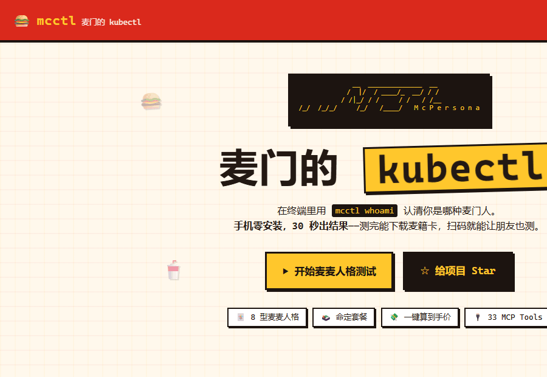
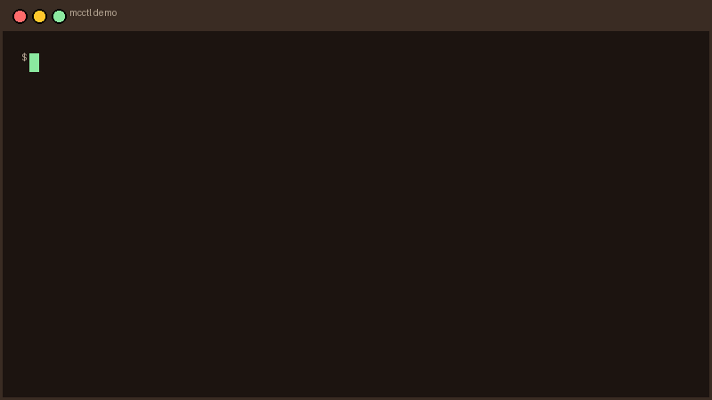
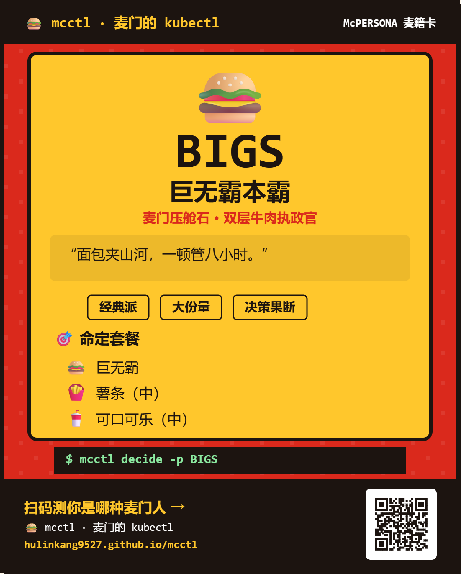
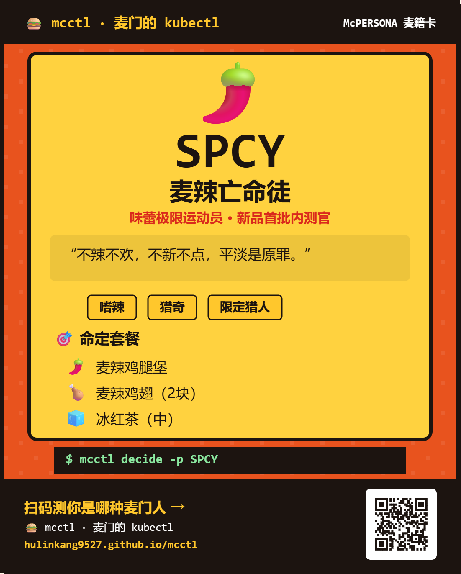
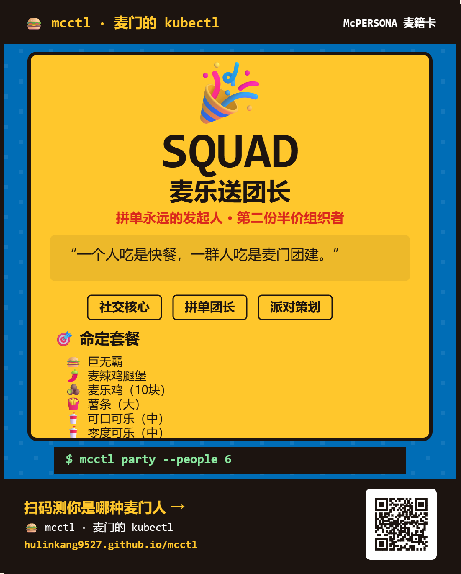
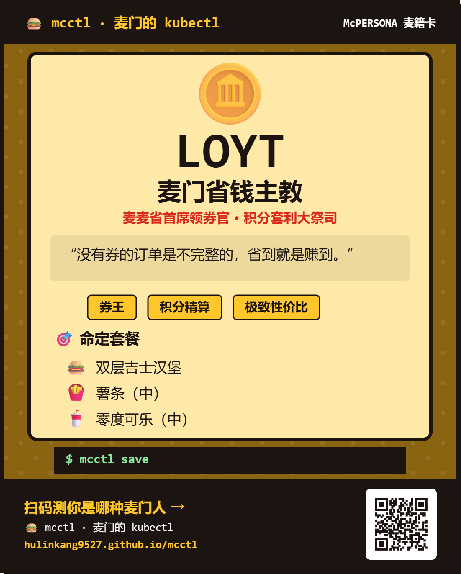

<p align="center">
  
</p>

<h1 align="center">mcctl — 麦门的 kubectl</h1>

<p align="center">
  <b>The kubectl for McDonald's China · 麦当劳中国 MCP 的命令行控制面</b>
</p>

<p align="center">
  <a href="https://hulinkang9527.github.io/mcctl/"></a>
  <a href="https://github.com/hulinkang9527/mcctl/actions/workflows/ci.yml"></a>
  <a href="https://github.com/hulinkang9527/mcctl/stargazers"></a>
</p>

<p align="center">
  
  
  
  
  
  
</p>

<p align="center">
  
</p>

---

`mcctl` 把麦当劳中国官方 MCP 开放的 **33 个工具** 编排成一套程序员命令：人格测试、控卡配餐、一键领券凑单、安全下单、积分兑换、派对预约，还能作为 **Agent Skill** 装进 WorkBuddy / Cursor，或直接打开**网页 Playground** 玩。

> 程序员节快乐。`kubectl` 管你的集群，`mcctl` 管你的麦门。

## ✨ 亮点

- 🃏 **麦麦人格测试**：**8 题麦门人格测试**（前 7 题二选一 + 第 8 题终局四选一）测出 8 型 McPersona，生成可下载、可分享的像素风**麦籍卡**；人格是一套可计算的营养 / 口味权重，直接驱动配餐。
- 💸 **真·省钱引擎**：一键领券 → 逐券试算 → 智能凑单，给你"基线 → 优惠 → 实付"和节省百分比，**拒绝伪优惠**。
- 🛒 **安全下单闭环**：到店 / 外送全链路，所有交易默认**演练**，必须 `--confirm`，真实环境跳转官方支付、**不自动扣款**。
- 🎉 **麦麦派对策划师（主打）**：`mcctl party plan` 把「城市 → 门店 → 日期 → 场次」做成约束求解——人数 / 预算 / 期望日期 / 名额硬约束卡死，输出 Top3 方案，`--confirm` 一键预约。
- 🔌 **33 个 MCP 工具全量接入**：真实 Client + 离线 Mock 自动降级，**clone 即零配置体验**，配 Token 切真实数据。四种形态：Python 包 + CLI、Agent Skill、网页 Playground、可复用 SDK。

## 🚀 快速开始

**方式一（零安装 · 手机点开即玩）**：打开 [**网页 Playground**](https://hulinkang9527.github.io/mcctl/)（手机也能玩）：8 题测人格 → 命定套餐 → 下载 / 分享麦籍卡。

> 网页 Playground 为**离线演示**（纯静态、内置示例菜单与价格），用于展示人格测试与配餐逻辑；
> 真实 MCP 工具调用请在 CLI 实时模式下验证（方式二 / 方式四）。

**方式二（PyPI · 一行命令体验）**：

```bash
pip install mcd-mcctl      # Python 包名为 mcd-mcctl，命令行入口仍为 mcctl
mcctl demo                 # 一键串演：人格→配餐→省钱→下单演练→积分
mcctl whoami               # 8 题测麦麦人格
mcctl decide -p FITA       # 板烧修行者的命定套餐
```

> 说明：PyPI 上的 `mcctl` 包名已被无关的第三方项目占用，所以发行包名为 `mcd-mcctl`；安装后命令行入口仍是 `mcctl`，无需修改使用习惯。

**方式三（从源码）**：

```bash
git clone https://github.com/hulinkang9527/mcctl.git && cd mcctl
pip install -e .
mcctl demo
```

**方式四（接入真实 MCP）**：到 <https://open.mcd.cn/mcp> 申请 Token，然后 `export MCD_MCP_TOKEN=你的Token && mcctl --live tools`。通用 MCP Client（WorkBuddy / Cursor / VS Code …）直接使用 [`mcp-config.example.json`](mcp-config.example.json)。

## 📺 终端演示

<p align="center">
  
</p>

> 安装后一条 `mcctl demo` 即可串演：人格测试 → 配餐 → 领券凑单 → 下单演练 → 积分活动。

## 🕹️ 网页演示（零安装，手机直接玩）

<p align="center">
  
</p>

<p align="center">
  <a href="https://hulinkang9527.github.io/mcctl/"><b>👉 点我打开在线 Playground</b></a>
  · 打开后点「⚡ 一键看完整示例」，即可看到 条件 → 套餐 → 优惠对比 → 推荐理由。
</p>

<p align="center">
  
  
  
  
</p>

## 🏗️ 架构速览

```
            mcctl 命令行 (Typer + Rich)          网页 Playground (纯静态)
                       │                                  │
              ┌────────▼─────────┐              ┌──────────▼──────────┐
              │  业务编排层 service│              │  内置数据 + 前端逻辑  │
              │  decide/diet/save │              │  (无后端，免登录)    │
              │  party/order/...  │              └─────────────────────┘
              └────────┬─────────┘
                       │ 33 个 MCP 工具
              ┌────────▼────────────────┐
              │  MCP 客户端 (mcp_client) │
              │  实时官方  →  离线 Mock  │  连不上自动降级，不静默出错
              └─────────────────────────┘
```
完整设计见 [`docs/ARCHITECTURE.md`](docs/ARCHITECTURE.md)。

## 🧭 命令速览

| 命令 | 作用 |
|---|---|
| `mcctl whoami` | 麦麦人格测试 + 麦籍卡 |
| `mcctl decide / diet / lunch` | 人格化 / 控卡配餐 |
| `mcctl menu / stores / calendar` | 菜单营养 / 门店 / 活动 |
| `mcctl coupons / save` | 领券 / 凑单 / 到手价 |
| `mcctl order new/track/list/cancel` | 下单 / 跟踪 / 取消 |
| `mcctl points / redeem / lottery` | 积分 / 兑换 / 抽奖 |
| `mcctl party plan` | 🎉 派对策划师：约束求解最优场次 |
| `mcctl tools / config / demo` | 工具清单 / 配置 / 一键演示 |

完整手册见 [`docs/COMMANDS.md`](docs/COMMANDS.md)。

## 🃏 八型麦麦人格

| | 代号 | 人格 | 本命餐 |
|---|---|---|---|
| 🍔 | `BIGS` | 巨无霸本霸 | 巨无霸 + 薯条 + 可乐 |
| 🥗 | `FITA` | 板烧修行者 | 板烧鸡腿堡 + 苹果片 + 纯净水 |
| 🌶️ | `SPCY` | 麦辣亡命徒 | 麦辣鸡腿堡 + 辣翅 + 冰红茶 |
| 🍦 | `SWEET` | 麦旋风甜心 | 麦旋风 + 菠萝派 + 橙汁 |
| ☕ | `EARL` | 麦满分绅士 | 猪柳蛋麦满分 + 脆薯饼 + 咖啡 |
| 🌙 | `NITE` | 麦夜骑士 | 脆汁鸡堡 + 麦乐鸡 + 零度可乐 |
| 🎉 | `SQUAD` | 麦乐送团长 | 双堡 + 麦乐鸡 + 大薯 + 双饮 |
| 🪙 | `LOYT` | 麦门省钱主教 | 双层吉士堡 + 薯条 + 零度可乐 |

## 🛡️ 安全与合规

- 写操作默认 dry-run，无 `--confirm` 不执行；不碰支付与凭证，仓库不含真实密钥。
- 本项目为麦当劳程序员创意开发大赛（M-CODE / 1024）**非官方**开源创意作品，演示数据为非官方示例，餐品 / 价格以官方实时结果为准。

## 📚 文档

[架构](docs/ARCHITECTURE.md) · [命令手册](docs/COMMANDS.md) · [人格图鉴](docs/PERSONAS.md) · [派对策划师](docs/PARTY.md) · [MCP 集成](MCP_INTEGRATION.md) · [Agent Skill](skill/SKILL.md) · [参赛声明（官方原文）](CONTEST_DECLARATION.md)

## 🧪 开发与测试

```bash
pip install -e ".[dev]"
pytest                      # 人格 / 配餐 / 省钱 / 派对策划 / 33 工具状态机 / 字段容错
```

## 📮 参赛说明

参加 **2026 麦当劳程序员创意开发大赛（M-CODE / 1024 程序员节）**，官方合作伙伴为腾讯 WorkBuddy。欢迎 ⭐ Star、Fork、提 Issue。**如果你也觉得好玩/有用，点个 Star 就是投票**，比赛以 GitHub Star 排名，谢谢麦门同门 🙏。

> 本项目为麦当劳程序员创意开发大赛**非官方**开源创意作品，与麦当劳无隶属关系；请通过实际体验与正当社区分享支持项目，拒绝任何刷榜行为。

## 📄 许可证

[MIT](LICENSE)。不授予任何麦当劳商标权利；请遵守麦当劳中国 MCP《使用条款》与《服务规则》。
