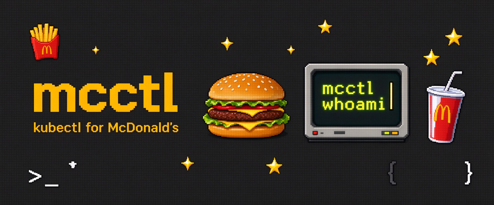

<p align="center">
  
</p>

<h1 align="center">mcctl — 麦门的 kubectl</h1>

<p align="center">
  <b>The kubectl for McDonald's China · 麦当劳中国 MCP 的命令行控制面 &amp; 智能体 Skill</b>
</p>

<p align="center">
  
  
  
  
  
  
</p>

<p align="center">
  <b>🍔 先认清你是哪种麦门人：</b><code>mcctl whoami</code>　
  <b>🧾 再让它帮你算最省到手价：</b><code>mcctl save</code>
</p>

---

`mcctl` 把麦当劳中国官方 MCP（Model Context Protocol）开放的 **33 个工具**，编排成一套程序员一看就懂的命令行：
人格测试、控卡配餐、一键领券凑单、安全下单、积分兑换、活动日历、派对预约——还能作为 **Agent Skill** 装进 WorkBuddy / Cursor，
或打开**零安装网页 Playground** 直接玩。

> 程序员节快乐。`kubectl` 管你的集群，`mcctl` 管你的麦门。

## ✨ 为什么会有它

- 🃏 **麦麦人格测试（社交入口）**：10 道题测出 8 型 McPersona（巨无霸本霸 / 板烧修行者 / 麦辣亡命徒 / 麦旋风甜心 / 麦满分绅士 / 麦夜骑士 / 麦乐送团长 / 麦门省钱主教），生成可下载、可分享的像素风**麦籍卡**。
- 🍱 **人格化命定套餐**：人格不是标签，而是一套可计算的营养 / 口味权重；配餐引擎在真实菜单里做组合搜索，热量、蛋白、预算、忌口、时段、人数硬约束卡死，再给本命餐加权。
- 💸 **真·省钱引擎**：一键领券 → 无券基线 → 逐券试算 → 智能凑单 / 免配送费，给你"基线→优惠→实付"和节省百分比；单品券 / 品类券 / 组合券都会校验餐篮，**拒绝伪优惠**。
- 🛒 **安全下单闭环**：到店取餐 / 麦乐送全链路；所有交易动作默认**演练**，必须 `--confirm`，真实环境跳转官方支付、**不自动扣款**。
- 🎉 **麦麦派对策划师（主打）**：`mcctl party plan` 把「城市→门店→日期→场次」全链路做成约束求解——人数、预算、期望日期、门店距离、周末偏好、剩余名额硬约束卡死，按人均成本 + 日期贴近度排序输出 Top3 方案和推荐理由，`--confirm` 一键预约。生日派对 / 品鉴会从"想办"到"约上"一步到位。
- 🔌 **33 个 MCP 工具全量接入**：真实 Client（官方 SDK / Streamable HTTP）+ 离线 Mock Client 自动降级，**clone 即可零配置体验**，配 Token 即切真实数据。
- 🧩 **四种形态**：Python 包 + Typer/Rich CLI、Agent Skill（`skill/SKILL.md`）、纯静态网页 Playground（`web/`）、可复用 Python SDK。

## 🚀 快速开始

### 方式一：网页 Playground（零安装，30 秒玩到）

在线玩：[**hulinkang9527.github.io/mcctl**](https://hulinkang9527.github.io/mcctl/)（已部署到 GitHub Pages，手机也能开），或本地打开 [`web/index.html`](web/index.html)：完成麦麦人格测试 → 查看命定套餐 → 下载 / 分享麦籍卡。

### 方式二：命令行（离线演示，无需 Token）

```bash
git clone https://github.com/hulinkang9527/mcctl.git
cd mcctl
pip install -e .

mcctl demo            # 一键串演：人格→配餐→省钱→下单演练→活动→积分
mcctl whoami          # 麦麦人格测试
mcctl decide -p FITA  # 板烧修行者的命定套餐
mcctl save --cart "巨无霸:1,薯条(中):1,可口可乐(中):1"
```

### 方式三：接入真实麦当劳 MCP

到 <https://open.mcd.cn/mcp> 用手机号申请 Token，然后：

```bash
export MCD_MCP_TOKEN=你的Token
mcctl --live tools          # 列出官方 33 个工具
mcctl --live calendar       # 真实当月活动
```

通用 MCP Client（WorkBuddy / Cursor / Cherry Studio / Trae / VS Code …）可直接使用 [`mcp-config.example.json`](mcp-config.example.json)：

```json
{
  "mcpServers": {
    "mcd-mcp": {
      "type": "streamablehttp",
      "url": "https://mcp.mcd.cn",
      "headers": { "Authorization": "Bearer ${MCD_MCP_TOKEN}" }
    }
  }
}
```

## 📺 终端演示

```text
$ mcctl whoami
🪪 你是：板烧修行者（FITA）— 高蛋白苦行僧 · 体脂率刺客
   “板烧去酱，可乐换零，人生也要做减法。”

$ mcctl decide -p FITA
🥗 板烧鸡腿堡 + 杯装玉米粒 + 鲜煮咖啡
   人均 525 kcal · 蛋白质 30g · ¥40
   理由：蛋白质 30g 达标；饮品选了低糖/无糖，控卡更稳。

$ mcctl save --cart "巨无霸:1,薯条(中):1,可口可乐(中):1"
   ① 一键领券 6 张   ② 无券基线 ¥46.00
   ③ 满40减10        ④ 无需凑单
   👉 实付 ¥36.00，本轮省 ¥10.00（21.7%）

$ mcctl order new --cart "巨无霸:1,薯条(中):1,零度可乐(中):1"
   ⚠ 安全护栏：未加 --confirm，仅演练不执行 → 创建到店取餐订单 ¥36.00

$ mcctl party plan --city 上海 --people 8 --budget 600 --date-hint 2026-10-25
   🎉 派对策划方案（上海 · 8人）
   ① 外滩中山东一路餐厅 · 10-25 14:00-15:30 · ¥576（人均¥72 · 正好命中期望日期）
   ② 陆家嘴环路餐厅     · 10-25 14:00-15:30 · ¥600（人均¥75）
   ③ 陆家嘴环路餐厅     · 10-24 16:30-18:00 · ¥496（人均¥62 · 距期望日期差1天）
   → 麦麦派对策划师：人数/预算/日期/名额约束自动求解，追加 --confirm 一键预约
```

## 🧭 命令速览

| 命令 | 作用 | 用到的 MCP 工具（节选） |
|---|---|---|
| `mcctl whoami` | 麦麦人格测试 + 麦籍卡 | 本地引擎 + `list-nutrition-foods` |
| `mcctl decide / diet / lunch` | 人格化 / 控卡配餐 | `now-time-info` `list-nutrition-foods` `campaign-calendar` |
| `mcctl menu / stores / calendar` | 菜单营养 / 门店 / 活动 | `list-nutrition-foods` `query-nearby-stores` `campaign-calendar` |
| `mcctl coupons / save` | 领券 / 凑单 / 到手价 | `available-coupons` `auto-bind-coupons` `query-my-coupons` `calculate-price` |
| `mcctl order new/track/list/cancel` | 下单 / 跟踪 / 取消 | `calculate-price` `create-order` `query-order` `order-list` `cancel-order` |
| `mcctl points / redeem / lottery` | 积分 / 兑换 / 抽奖 | `query-my-account` `mall-points-products` `mall-create-order` `draw-lottery` |
| `mcctl party cities/book` | 派对 / 品鉴会预约 | `query-party-*` `party-order-create` |
| `mcctl party plan` | 🎉 麦麦派对策划师：按人数/预算/日期自动求解最优场次 | `query-party-*` + 约束求解引擎 `engines/party.py` |
| `mcctl tools / config / demo` | 工具清单 / 配置 / 一键演示 | `tools/list` 等 |

完整手册见 [`docs/COMMANDS.md`](docs/COMMANDS.md)，33 工具与调用流程见 [`MCP_INTEGRATION.md`](MCP_INTEGRATION.md)。

## 🃏 八型麦麦人格

| | 代号 | 人格 | 本命餐 |
|---|---|---|---|
| 🍔 | `BIGS` | 巨无霸本霸 | 巨无霸 + 薯条 + 可乐 |
| 🥗 | `FITA` | 板烧修行者 | 板烧鸡腿堡 + 苹果片 + 纯净水 |
| 🌶️ | `SPCY` | 麦辣亡命徒 | 麦辣鸡腿堡 + 辣翅 + 冰红茶 |
| 🍦 | `SWEET` | 麦旋风甜心 | 麦旋风 + 菠萝派 + 橙汁 |
| ☕ | `EARL` | 麦满分绅士 | 猪柳蛋麦满分 + 脆薯饼 + 咖啡 |
| 🌙 | `NITE` | 麦夜骑士 | 脆汁鸡堡 + 麦乐鸡 + 零度可乐 |
| 🎉 | `SQUAD` | 麦乐送团长 | 双堡 + 麦乐鸡 + 大薯 + 双饮 |
| 🪙 | `LOYT` | 麦门省钱主教 | 双层吉士堡 + 薯条 + 零度可乐 |

详见 [`docs/PERSONAS.md`](docs/PERSONAS.md)。

## 🛡️ 安全与合规

- **写操作默认 dry-run**：下单 / 取消 / 领券 / 兑换 / 抽奖 / 派对预约，无 `--confirm` 不执行。
- **不碰支付与凭证**：仅生成官方支付链接；Token 只从环境变量读取，仓库不含任何真实密钥（配置仅用 `${MCD_MCP_TOKEN}` 占位）。
- **理性提示**：抽奖明示概率并提示量力而行；营养信息仅供参考、不构成医疗 / 营养建议。
- **非官方声明**：本项目为麦当劳程序员创意开发大赛（M-CODE / 1024）的**非官方**开源创意作品，与麦当劳无隶属关系；演示数据为非官方示例，餐品 / 价格 / 供应以麦当劳官方渠道实时结果为准。

## 📚 文档

- [架构设计](docs/ARCHITECTURE.md) · [命令手册](docs/COMMANDS.md) · [人格图鉴](docs/PERSONAS.md) · [派对策划师](docs/PARTY.md)
- [MCP 集成说明](MCP_INTEGRATION.md) · [离线演示 / 录屏脚本](docs/DEMO.md) · [合规传播设计](docs/WIN-STRATEGY.md)
- [Agent Skill](skill/SKILL.md) · [WorkBuddy 开发上下文](workbuddy.md) · [参赛声明（官方原文，未改动）](CONTEST_DECLARATION.md)

## 🧪 开发与测试

```bash
pip install -e ".[dev]"
pytest                      # 41 个用例：人格 / 配餐 / 省钱 / 派对策划 / 33 工具状态机 / 字段容错
mcctl --mock demo           # 离线冒烟
```

## 📮 参赛说明

本项目参加 **2026 麦当劳程序员创意开发大赛（M-CODE / 1024 程序员节）**，官方合作伙伴为腾讯 WorkBuddy。
欢迎 ⭐ Star、Fork、提 Issue 一起加新人格 / 新餐品 / 新语言。**请通过实际体验与正当社区分享支持项目，拒绝任何刷榜行为。**

## 📄 许可证

[MIT](LICENSE)。本项目不授予任何麦当劳商标权利；请遵守麦当劳中国 MCP《使用条款》与《服务规则》。
